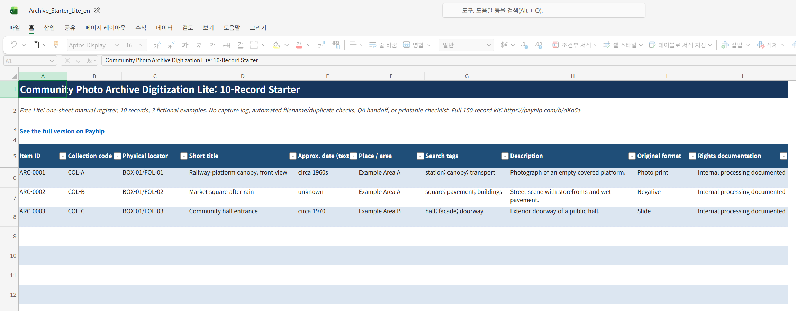
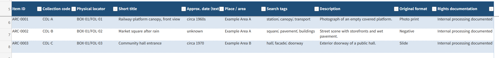

# Community Photo Archive Digitization Lite
## Free 10-Record Starter Spreadsheet

### Start organizing a small community photo archive — one record at a time.

**Free Excel Template · 10 Item Rows · 3 Fictional Examples · Manual Recordkeeping · No Subscription**

Community Photo Archive Digitization Lite is a free, beginner-friendly Excel starter for organizing basic information about a small photo collection.

Designed for community archive volunteers, local history groups, small cultural organizations, and hobby archivists, this Lite edition provides a simple introduction to manual photo archive recordkeeping.

Start with a single worksheet and 10 item rows before deciding whether you need a larger digitization workflow.

**What you get:**
- One editable Excel worksheet
- 10 item-record rows
- 3 clearly fictional examples
- Manual item registration
- A lightweight introduction to structured archive records

No specialized archive software is required.

### Get the Free Lite Edition

[](./community-photo-archive-lite.zip)

[](./Archive_Starter_Lite_en.xlsx)

[](https://payhip.com/b/yKMiH)

### Preview the Actual Lite Workbook



*Actual product screenshot of the Community Photo Archive Digitization Lite workbook. The displayed archive information is fictional sample data for demonstration purposes, not real people or historical collection records.*

**Need more capacity and a structured digitization workflow?**

[](https://payhip.com/b/dKo5a)

---

## The Problem: Small Photo Collections Still Need Organized Records

Community photo collections often begin with loose files, folders, printed photographs, and handwritten notes.

Even a small collection can become difficult to organize when basic item information is not recorded consistently.

You may need a simple way to:

- Give each photo item its own record.
- Keep basic collection information together.
- Establish a consistent manual registration process.
- Introduce volunteers to structured archive documentation.
- Try a spreadsheet-based approach before adopting a larger workflow.

**Community Photo Archive Digitization Lite offers a small, practical starting point.**

It focuses on manual item registration rather than automated digitization management.

---

## What's Included in the Free Lite Edition?

### 1. A Single Excel Worksheet

The Lite workbook contains **one worksheet** for manual photo archive item registration.

It is intentionally limited in scope to make the starter approachable.

There are no separate workflow-management tabs, automated QA systems, or advanced processing tools in this free version.

### 2. Ten Item-Record Rows

The workbook provides space for **10 photo archive item records**.

Use the available rows to practice recording basic archive information for a small test collection.

The Lite edition is a fixed-size starter, not the complete 150-record kit.

### 3. Three Fictional Examples

Three sample records demonstrate how an archive item register can be populated.

All three examples are fictional.

They are provided to illustrate the recording format, not to represent real photographs, people, historical events, or archival holdings.

### 4. Manual Item Registration

The workbook supports a straightforward manual recordkeeping process.

You enter and maintain item information yourself.

The Lite edition does **not** provide:

- A separate capture log
- Automated filename checks
- Automated duplicate checks
- A QA and handoff workflow
- Printable digitization checklists

These capabilities belong to the paid Full edition.

### Actual Workbook Records Preview



*Actual product screenshot of the Lite Excel item-register worksheet. All example entries shown are fictional and intended solely to demonstrate manual data entry and record organization.*

---

## Download the Free Archive Starter

Choose the format that works best for you.

### Option 1 — Complete Lite ZIP Package (Recommended)

Download the full free starter package:

[](./community-photo-archive-lite.zip)

**File:** `community-photo-archive-lite.zip`

The ZIP contains exactly two files:

```text
community-photo-archive-lite.zip
├── Archive_Starter_Lite_en.xlsx
└── README_en.md
```

| Included File | Purpose |
|---|---|
| `Archive_Starter_Lite_en.xlsx` | Editable Excel workbook for manual item records |
| `README_en.md` | Starter documentation and usage guidance |

### Option 2 — Excel Workbook Only

Already familiar with the product and only need the spreadsheet?

[](./Archive_Starter_Lite_en.xlsx)

**File:** `Archive_Starter_Lite_en.xlsx`

This is the same Lite workbook included in the ZIP.

### Option 3 — Free Payhip Product Page

Access the free Lite edition through the official Payhip listing:

[](https://payhip.com/b/yKMiH)

**Official Free Product:**

https://payhip.com/b/yKMiH

---

## How to Use the Lite Workbook Locally

No command line, development environment, database, or web server is required.

### Step 1 — Download

Download either:

- `community-photo-archive-lite.zip`
- `Archive_Starter_Lite_en.xlsx`

The ZIP option also includes the README documentation.

### Step 2 — Extract the ZIP (If Applicable)

**Windows:**
Right-click the ZIP and select **Extract All**.

**macOS:**
Double-click the ZIP to extract the files.

If you downloaded the standalone XLSX workbook, skip this step.

### Step 3 — Open the Excel Workbook

Open:

`Archive_Starter_Lite_en.xlsx`

Use Microsoft Excel or another spreadsheet application capable of opening XLSX files.

For the most predictable formatting and behavior, Microsoft Excel is the preferred option. Compatibility with other applications should be checked independently.

### Step 4 — Review the Fictional Examples

Inspect the three fictional example records.

Use them to understand the worksheet's manual registration format.

Do not treat the examples as real historical or archival information.

### Step 5 — Enter Your Own Test Records

Use the available item rows to practice manual archive registration.

The workbook supports up to 10 item rows in this starter edition.

If you replace example entries with your own data, keep the total within the 10-row Lite capacity.

### Step 6 — Save Your Workbook

Save the completed or partially completed Excel file locally using your spreadsheet application's normal save function.

This is standard spreadsheet file saving, not a specialized project-saving or archive-management feature.

**Tip:** Keep an unchanged copy of the original template before entering test records.

---

## Free Lite vs. Paid Full — Feature Comparison

The free Lite edition is designed for small-scale evaluation and manual registration.

The paid **Community Photo Archive Digitization Full Kit** expands capacity and introduces additional digitization recordkeeping and review tools.

| Feature | Free Lite Starter | Paid Full Kit |
|---|---|---|
| Archive item capacity | 10 records | 150 records |
| Manual item register | Yes | Yes |
| Fictional starter examples | 3 included | See Full product details |
| Lite worksheet count | 1 | Expanded kit |
| Dedicated capture log | No | Yes |
| Automated filename checks | No | Yes |
| Automated duplicate checks | No | Yes |
| QA workflow | No | Yes |
| Handoff workflow | No | Yes |
| Printable checklists | No | Yes |
| Primary purpose | Manual starter and evaluation | Expanded archive digitization workflow |
| Access | Free | Paid |

**Important:** Automated checks in the Full edition should not be interpreted as guarantees of complete error detection, archival accuracy, or successful digitization.

Review the official Full product listing before purchasing to confirm the included files, exact functionality, software requirements, compatibility, and suitability for your collection.

---

## Upgrade to the Full 150-Record Kit

### Move Beyond Basic Manual Registration

The free Lite edition helps you begin with a small item register.

If your archive project grows beyond the 10-record starter, or you need a more structured digitization process, the paid Full kit offers additional capacity and workflow tools.

### What the Full Edition Adds

**150-Record Capacity**

Expand beyond the 10-record starter with the larger paid kit.

**Capture Log**

Keep a dedicated record of digitization capture activity.

**Automated Filename Checks**

Use the Full edition's filename-checking functionality as part of a more structured review process.

**Automated Duplicate Checks**

Use the Full edition's duplicate-checking functionality to support record review.

**QA and Handoff Workflow**

Track quality-review and handoff activities within the expanded workflow.

**Printable Checklists**

Access dedicated printable checklists for manual workflow support.

These features are not included in Lite.

### Explore the Full Edition

[](https://payhip.com/b/dKo5a)

**Official Full Product Page:**

https://payhip.com/b/dKo5a

**Start free if you only need a small manual register. Consider Full when you need more record capacity and structured workflow tools.**

---

## Who Is This Starter For?

Community Photo Archive Digitization Lite is intended for people exploring small-scale archive organization.

It may be useful for:

- Community history volunteers
- Local heritage groups
- Small cultural organizations
- Amateur archivists
- Hobby photo collectors
- Students practicing basic archive recordkeeping
- Small teams evaluating a spreadsheet-based registration process

It is particularly suitable for users who want to test a simple manual workflow before considering the 150-record Full edition.

The workbook does not digitize physical photographs, scan images, or automatically manage photo files.

---

## Privacy and Responsible Sample Data

**Do not enter actual people's photographs, names, contact information, or other personally identifiable information into this demo workbook.**

Use fictional or non-identifying test data when exploring the Lite edition.

The three included examples are fictional.

For real archival projects, establish appropriate privacy, consent, access, and record-handling procedures before collecting or processing personal information.

This spreadsheet does not provide privacy compliance or data-security guarantees.

---

## Frequently Asked Questions

### Is Community Photo Archive Digitization Lite free?

Yes.

The Lite starter is available free through this GitHub repository and the official Payhip product page.

### What files are included in the ZIP?

The ZIP contains:

1. `Archive_Starter_Lite_en.xlsx`
2. `README_en.md`

No additional software is required to extract the ZIP.

### Can I download just the Excel workbook?

Yes.

The standalone `Archive_Starter_Lite_en.xlsx` file is available directly from this repository.

### How many records can I enter?

The Lite workbook provides 10 item rows.

The paid Full kit supports 150 records.

### Are the examples based on real community archives?

No.

The Lite edition contains three fictional examples for demonstration purposes.

### Does Lite include a photo capture log?

No.

The separate capture log is a paid Full edition feature.

### Does Lite automatically check filenames?

No.

Automated filename checks are excluded from Lite and included in Full.

### Does Lite detect duplicate filenames or records?

No.

Lite is a manual item register and does not include automated duplicate checking.

The paid Full edition provides duplicate-checking functionality.

### Does Lite provide QA or handoff tracking?

No.

The QA and handoff workflow belongs to the paid Full edition.

### Does Lite include printable checklists?

No.

Printable digitization checklists are part of the Full kit.

### Does the workbook scan or digitize photographs?

No.

It is a spreadsheet for archive item recordkeeping, not photo-scanning or image-processing software.

### Can I use my own records?

The worksheet is editable, but the free edition is intended as a small starter.

For evaluation, use fictional or non-identifying records rather than real people's personal information.

### Can I save changes locally?

Yes.

Save the XLSX file using the normal Save or Save As function in your spreadsheet application.

There is no separate archive database or synchronization system in the Lite edition.

### Do I need an internet connection to use the spreadsheet?

No.

After downloading the files, you can open and edit the workbook locally using a compatible spreadsheet application.

### Does it work with Google Sheets or LibreOffice?

The supplied file is an XLSX workbook.

Other spreadsheet applications may be able to open it, but formatting and compatibility have not been independently confirmed. Test your intended application before relying on it.

### Is this an archival standards-certified solution?

No.

The workbook is a practical starter template and does not claim certification, regulatory compliance, or adherence to a specific archival standard.

### Where can I purchase the Full 150-record kit?

Visit:

https://payhip.com/b/dKo5a

---

## Repository Contents

```text
community-photo-archive-digitization-lite/
├── README.md
├── community-photo-archive-lite.zip
├── Archive_Starter_Lite_en.xlsx
├── archive-starter-lite-overview.png
└── archive-starter-lite-records.png
```

| File | Description |
|---|---|
| `README.md` | GitHub landing page and product instructions |
| `community-photo-archive-lite.zip` | Complete free Lite download package |
| `Archive_Starter_Lite_en.xlsx` | Standalone editable Lite workbook |
| `archive-starter-lite-overview.png` | Actual Lite product overview screenshot |
| `archive-starter-lite-records.png` | Actual Lite records worksheet screenshot |

The two PNG files show actual product screens with fictional example content.

---

## Important Scope and Disclaimer

Community Photo Archive Digitization Lite is an introductory spreadsheet template for manual item registration.

The Lite edition includes:

- One Excel worksheet
- 10 item-record rows
- Three fictional examples
- Manual recordkeeping functionality

The Lite edition does not include:

- A dedicated capture log
- Automated filename validation
- Automated duplicate checks
- QA or handoff workflow tools
- Printable digitization checklists
- Photo scanning or image processing

The workbook does not guarantee archival completeness, metadata accuracy, data security, privacy compliance, or preservation outcomes.

Users remain responsible for verifying entered information, maintaining backups, selecting compatible software, and implementing appropriate privacy and archival procedures.

---

## Official Product Links

| Product | Access | Link |
|---|---|---|
| Community Photo Archive Lite ZIP | Free GitHub download | [Download ZIP](./community-photo-archive-lite.zip) |
| Community Photo Archive Lite Excel | Free standalone workbook | [Download XLSX](./Archive_Starter_Lite_en.xlsx) |
| Community Photo Archive Lite | Free Payhip product | [Get Free Lite](https://payhip.com/b/yKMiH) |
| Community Photo Archive Full | Paid 150-record kit | [View Full Kit](https://payhip.com/b/dKo5a) |

---

## Start Your Photo Archive Register for Free

Explore a simple, structured way to document up to 10 archive items using an editable Excel worksheet and fictional sample entries.

**Download the free starter and practice manual recordkeeping locally.**

[](./community-photo-archive-lite.zip)

[](./Archive_Starter_Lite_en.xlsx)

### Need a Larger Archive Workflow?

Explore the paid 150-record Full kit with its dedicated capture log, automated filename and duplicate checks, QA/handoff workflow, and printable checklists.

[](https://payhip.com/b/dKo5a)